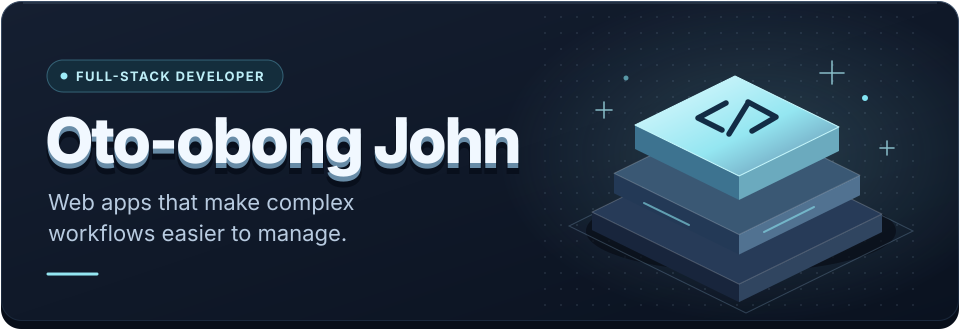
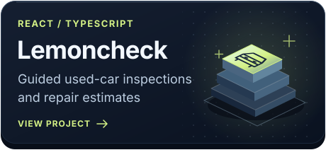
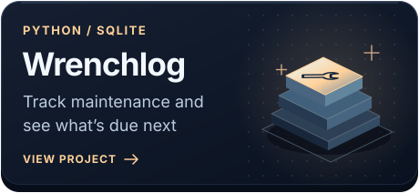
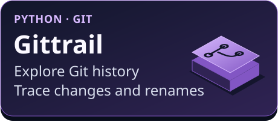

  

  <a href="https://lemoncheck-red.vercel.app/">Try Lemoncheck</a>
  &nbsp;·&nbsp;
  <a href="https://github.com/Ibom1?tab=repositories">Browse my repositories</a>

## Selected projects

  
  

  
  

## About me

I’m Oto-obong John, a full-stack developer. I work on both the interface people use and the logic that makes it work. I’m drawn to problems where people have too many steps to keep track of. I like figuring out what the software can handle for them and how to make the next step clear.

**Core stack:** React · TypeScript · JavaScript · C# / .NET · Azure
